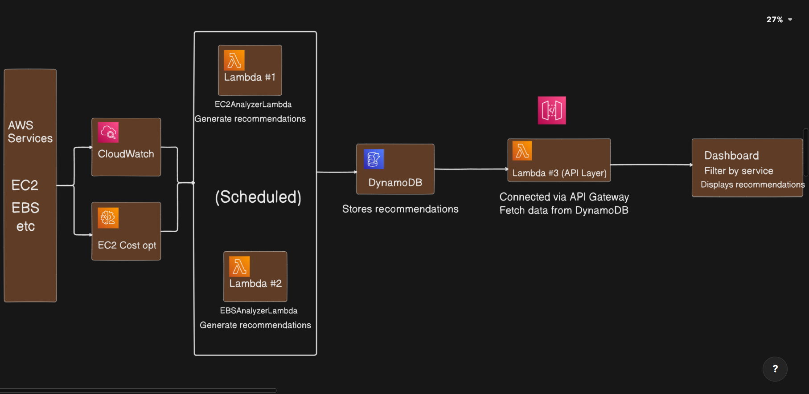

<div align="center">
    
    
    
    
    
    
    
    
</div>

---

# **AWS Cost Optimization Tool 💰**

An intelligent, automated AWS cost optimization solution that identifies underutilized resources, provides actionable recommendations, and offers automated remediation capabilities.

## **📋 Project Overview**

This project implements a comprehensive AWS cost optimization system that helps organizations reduce cloud spending by identifying and addressing resource inefficiencies. The solution analyzes EC2 instances and EBS volumes, providing real-time recommendations through an intuitive dashboard.

## **🌚 Key Features**

- **Automated Resource Analysis:** Continuously monitors EC2 instances and EBS volumes for optimization opportunities
- **Intelligent Recommendations:** Identifies idle instances, unattached volumes, outdated storage types, and more
- **Interactive Dashboard:** React.js-based web interface for viewing and managing recommendations
- **Automation:** Automated actions to implement cost-saving measures
- **Real-time Monitoring:** Integration with CloudWatch for performance metrics

## **🧩 Architecture Components**

- **AWS Lambda:** Serverless functions for resource analysis and API endpoints
- **Amazon DynamoDB:** NoSQL database for storing recommendations and metadata
- **Amazon API Gateway:** RESTful API layer for dashboard communication
- **Amazon EventBridge:** Scheduled triggers for the analyzer functions
- **AWS CloudWatch:** Metrics collection and monitoring
- **React.js Dashboard:** Modern web interface for recommendation management

## **🏗️ System Architecture**



## **📸 Project Screenshots**

### **Screenshot 1**


### **Screenshot 2**


### **Screenshot 3**


### **Screenshot 4**


### **Screenshot 5**


### **Screenshot 6**


### **Screenshot 7**


### **Screenshot 8**


### **Screenshot 9**


### **Screenshot 10**


### **Screenshot 11**


## **🚀 Quick Start Guide**

### **Prerequisites**
- AWS Account
- Basic knowledge of Lambda, DynamoDB, API Gateway and CloudWatch

### **Step 1: Create IAM Roles**

> **Why create roles?** Our Lambda functions need to access other AWS services (EC2, EBS, DynamoDB, etc.), so we create roles and attach them to the functions.

**Role 1: `cost_optimization_role`** (used by the analyzer Lambdas)
- Attach these AWS managed policies:
    - `AmazonDynamoDBFullAccess`
    - `AmazonEC2ReadOnlyAccess`
    - `CloudWatchReadOnlyAccess`
- Create an inline policy named `ec2_optimizer`:
    ```json
    {
        "Version": "2012-10-17",
        "Statement": [
            {
                "Effect": "Allow",
                "Action": [
                    "compute-optimizer:GetEC2InstanceRecommendations"
                ],
                "Resource": "*"
            }
        ]
    }
    ```
- Create the role.

**Role 2: `apilambda-role`** (used by the API Lambda)
- Attach the AWS managed policy `AmazonDynamoDBFullAccess`
- Create an inline policy named `resource_delete_role_api`:
    ```json
    {
        "Version": "2012-10-17",
        "Statement": [
            {
                "Effect": "Allow",
                "Action": [
                    "ec2:StopInstances",
                    "ec2:TerminateInstances",
                    "ec2:DeleteVolume",
                    "ec2:DeleteSnapshot"
                ],
                "Resource": "*"
            }
        ]
    }
    ```
- Create the role.

Now we have our required roles.

> **🔒 Security note:** These broad permissions (`AmazonDynamoDBFullAccess`, `Resource: "*"` on destructive EC2 actions) keep the demo simple. In production, follow least privilege: scope policies to the `CostOptimization` table and to specific resources or tags.

### **Step 2: Create DynamoDB Table**
- Table name: `CostOptimization`
- Partition key: `ResourceId` (String)
- Sort key: `Issue` (String)
- Create table

### **Step 3: Create Lambda Functions**

#### **EC2AnalyzerLambda**
- Create a Lambda function named `EC2AnalyzerLambda`
- Choose `Author from scratch`
- Runtime: `Python 3.10`
- Under `Change default execution role`, choose `Use an existing role` and select `cost_optimization_role`
- Create function
- In the Code tab, paste the code from `EC2AnalyzerLambda.py` and hit `Deploy`

#### **EBSAnalyzerLambda**
- Create a Lambda function named `EBSAnalyzerLambda`
- Choose `Author from scratch`
- Runtime: `Python 3.10`
- Under `Change default execution role`, choose `Use an existing role` and select `cost_optimization_role`
- Create function
- In the Code tab, paste the code from `EBSAnalyzerLambda.py` and hit `Deploy`

#### **APILambda**
- Create a Lambda function named `APILambda`
- Choose `Author from scratch`
- Runtime: `Python 3.10`
- Under `Change default execution role`, choose `Use an existing role` and select `apilambda-role`
- Create function
- In the Code tab, paste the code from `APILambda.py` and hit `Deploy`

### **Step 4: Create API Gateway**
- Create an API and choose `REST API` (not Private)
- Name: `ResourceAnalyzerAPI`
- Hit create

Create the following three resources. For each one:
- `Integration type` = `Lambda`
- Check `Lambda proxy integration`
- Choose Lambda function `APILambda`
- `Deploy API` to the stage `dev` (create it the first time, then reuse it)

| Resource | Method |
|----------|--------|
| `recommendations` | `GET` |
| `update-status` | `POST` |
| `action` | `POST` |

### **Step 5: Create EventBridge Schedules**
- Create rule
- Name: `EC2AnalyzerLambdaScheduler`
- Rule type: `Schedule`, then `Continue to create rule`
- Cron: `cron(30 18 * * ? *)`, which runs every day at 18:30 UTC (12:00 AM IST)
- Target: `AWS service` → `Lambda function` → `EC2AnalyzerLambda`
- Create rule
- Repeat for `EBSAnalyzerLambdaScheduler`, keeping everything the same except the target function: `EBSAnalyzerLambda`

> **Note:** All necessary AWS services are now set up. Next, move to the `frontend` folder to set up the dashboard.

## **📈 Expected Results**
- **EC2 Optimization:** 15-30% reduction in compute costs
- **EBS Optimization:** 10-25% reduction in storage costs
- **Overall:** 20-35% reduction in total AWS bill

## **🤝 Contributing**
- Fork the repository
- Create a feature branch (`git checkout -b feature/amazing-feature`)
- Commit your changes (`git commit -m 'Add amazing feature'`)
- Push to the branch (`git push origin feature/amazing-feature`)
- Open a Pull Request

## **Built with ❤️ for AWS cost optimization**
